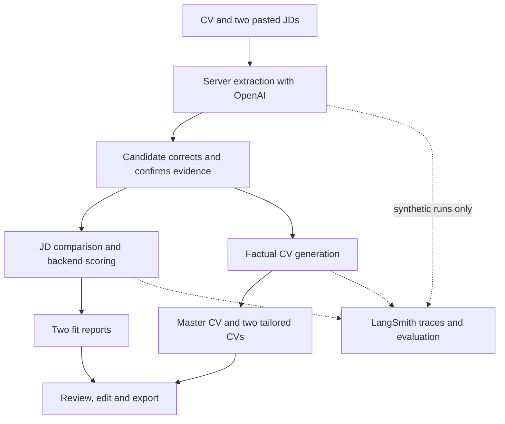

# Output C — Architecture and build decision

## Scope decision (Output B)
The smallest meaningful product converts one candidate-approved factual profile and two pasted JDs into two explainable alignment reports and three editable CVs. It replaces manual application of workshop advice with usable candidate documents. The existing app should be reused if its actual source supports this flow.

## Proposed stack
| Layer | Decision | Evidence/verification |
|---|---|---|
| Builder and app | Existing CTO.new project | Mandatory user choice; inspect actual repository first |
| UI | Current frontend, five result tabs | Preserve working app, verify live navigation |
| Backend | Existing secure server routes | Confirm runtime and secret mechanism from source |
| Inference | OpenAI Responses API, structured outputs | Official docs checked 9 Oct 2026; validate actual account/model access |
| Model | gpt-4.1-mini as a provisional cost baseline | Configurable, not a claim of best performance; evaluation decides |
| Knowledge | Curated Markdown rules in backend prompt context | Verify runtime prompt contains rules; builder attachment alone is insufficient |
| Scoring | Pure backend arithmetic | Proposed weights, N/A policy and uncertainty labels |
| Session | Browser memory, temporary backend extraction | No accounts/database required for P0 |
| Evaluation | LangSmith + actual-app adapter | Requires private key and real experiment |
| Exports | Copy and .txt | PDF/DOCX parsing/export only if supported and tested |
| Versioning | Existing repository, actual lockfile and deployment records | Not created as a hosted repo in this turn |

CTO's public docs confirm a builder, but do not establish this project's exact parser, database, auth or export behavior. Prompt 01 must inspect those capabilities. Public URL retrieval did not confirm current live-app state. The previously reported acceptance test is context, not a new verification.

## Data flow

## Sequential workflow
1. Validate inputs and size limits before paid inference.
2. Extract candidate evidence and exact source quotes.
3. Ask bounded clarification questions and obtain candidate confirmation. This is attestation, not external verification.
4. Parse both JDs and label essentials, preferred items and hard conditions.
5. Compare approved evidence, cite source IDs and assign documented status.
6. Compute all scores in deterministic code, show hard conditions independently.
7. Generate CV documents from the same factual profile and check provenance before rendering.
8. Candidate reviews and edits; old reports become stale if evidence or JDs change.
9. Capture synthetic evaluation traces with app/model/prompt versions.

The reference Python pipeline is an integration starting point for CTO, not evidence of a deployed application. No n8n, Pinecone, embedding service or multi-agent framework is needed for P0.

## Optional evolution
Add retrieval only when the approved source library is too large for curated context. Store passage metadata and audit returned citations. Add saved history only when user isolation, retention/deletion and private storage have been verified. Build permitted employer/board discovery after the current product passes evaluation and the pilot gate.
