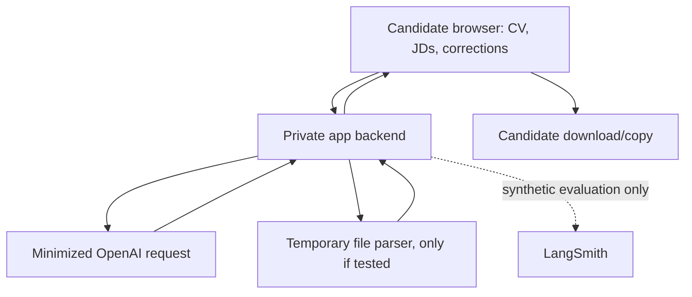

# GDPR documentation and short DPIA
Assessment date: 9 October 2026. Capstone: synthetic candidate data only. Production design below must be validated against actual provider configuration and contracts.

## Roles and legal bases
TechTalk would normally be controller for its member career-support service. Hosting, inference and evaluation vendors may be processors for contracted processing. Confirm each contract and any separate-controller processing instead of asserting a processor role for every activity. The consultant's role depends on the actual agreement. Establish Article 28 terms and subprocessors before real member data.

Use Article 6(1)(b) only for processing necessary to provide the candidate-requested career document service. Do not extend that basis to unrelated model training or marketing. Optional marketing uses separate opt-in consent where appropriate. Security telemetry may use Article 6(1)(f) after a legitimate-interest assessment and minimization. Do not use consent as a generic substitute for every necessary service activity.

CVs can contain Article 9 special-category data and third-party contact details. P0 does not need those data: instruct omission, strip unnecessary fields before inference and avoid protected-attribute scoring. Consent for special-category data, if ever needed, requires a separate assessment and appropriate Article 9 basis. Work authorization is a candidate-declared role condition, not a nationality inference. Do not collect passport images for this MVP.

## Data-flow map

No Circle membership, email, GitHub or LinkedIn account integration is currently implemented by this package. A pasted public URL is not evidence that the app fetched its contents.

## Processing activities register — proposed production settings
| Activity | Purpose/data | Proposed basis | Proposed retention | Recipients/controls |
|---|---|---|---|---|
| Input and profile confirmation | CV facts, role, JD, optional project, answers | 6(1)(b), necessity review | Session memory; temporary backend request only | Candidate/app owner; private transport and access |
| Temporary upload parsing | PDF/DOCX bytes if feature verified | 6(1)(b) | Delete immediately after extraction; failed files within 24h, verify cleanup | Hosting parser; no public storage |
| Inference | Minimized evidence and JD content | 6(1)(b) for requested support | App retains only session; provider logs/state depend on actual settings | OpenAI; contract/region/retention review |
| Review/export | Generated CVs, reports and edits | 6(1)(b) | Browser session; candidate chooses local download | Candidate controls onward sharing |
| Security telemetry | Request ID/error class, no CV or key | 6(1)(f), documented assessment | Proposed 30 days | Technical owner, access restricted |
| Synthetic evaluation | Fictional profiles, traces, references | No real candidate personal data intended | Proposed 90 days for capstone evidence, then review | LangSmith, assessors with controlled access |
| Support request | User-supplied diagnostic details | 6(1)(b) or assessed legitimate interest | Proposed 90 days after closure | Authorized support; minimize real CV uploads |

These are policy proposals. Inspect actual hosting, reverse proxies, framework logs, uploads, backups and third-party data behavior before promising deletion. Protect identifiers in logs even during synthetic evaluation if account metadata is involved.

## OpenAI and evaluation controls
The API data-control docs distinguish training, abuse monitoring and application state. API content is not used to train models by default, while abuse-monitoring logs may be retained for up to 30 days subject to stated exceptions. Responses store=false avoids normal saved response state but does not establish Zero Data Retention or erase abuse logs. Do not claim EU-only processing without actual eligible project/region configuration and contracts.

Keep LangSmith tracing off for real-data sessions until redaction, purpose, retention and transfers are approved. Synthetic-only experiment traces use version metadata. Choose the correct account-region endpoint rather than assuming the default is Europe. Vendor traces and browser session data have different deletion paths.

## Data-subject rights support
Provide a privacy notice before collection: controller contact, purposes/bases, recipients, transfers, retention, rights, complaint route and the role of AI. Contact and organizational details require the client's actual information; no real email/address is invented here.

Provide access/export of retained data, correction of candidate facts, erasure for retained app records, restriction, objection for legitimate-interest activities, and portability where applicable. Log and verify requests proportionately, acknowledge promptly and normally respond within one month with lawful extensions explained. Map processor assistance and deletion confirmation. P0 Clear session clears app memory, not third-party mandatory logs or the candidate's own downloads.

The app does not make legally or similarly significant employment decisions. Candidate-controlled recommendations can still amount to profiling and require transparency. Reassess Article 22 before future employer filtering, auto-applications, scoring used for selection or eligibility decisions. User editing is not a blanket Article 22 exemption.

## Cross-border transfers and vendor register
| Vendor | Data/purpose | Launch evidence required |
|---|---|---|
| CTO hosting/runtime vendor | Requests, temporary uploads, runtime logs | Legal entity, DPA/subprocessors, hosting region, retention/security |
| OpenAI | Minimized CV/JD inference | Contract, entity, retention settings, regional availability, subprocessors and lawful transfer mechanism |
| LangSmith | Synthetic test content; any later real traces | Contract/region, access, deletion, redaction and transfer assessment |
| Future Circle/billing vendors | No current processing integration | Separate data map, basis, DPA and scope review |

Where personal data leave the EEA, verify applicable adequacy arrangements or appropriate safeguards such as SCCs, with transfer-risk assessment/supplementary measures as needed. Do not assume EU-US adequacy applies to every vendor/entity or all processing. Record the actual mechanism and destination before real-data pilot.

## Short DPIA — highest-risk planned processing
**Description.** The system extracts professional history and analyzes requirements alignment. At scale it could influence candidates' career choices. A real-data launch combines new technology, evaluation/profiling and potentially sensitive CV content. Run a formal Article 35 screening using the relevant supervisory authority's list and complete a DPIA where likely high risk. This capstone supplies a short DPIA design record rather than asserting an exemption.

**Necessity/proportionality.** Candidate requests CV assistance. Use only relevant professional evidence. Email, date of birth, photos, marital status, passport records and account links are unnecessary for scoring. Paste-first, session-only operation minimizes collection. Show edit/review and source evidence before final CV use. Do not repurpose CVs for training, advertising or employer ranking.

**Risks and proposed controls.**
| Risk | Before L×I | Control | Residual L×I hypothesis |
|---|---:|---|---:|
| Disclosure of CV/sensitive data through vendor or logs | 3×5=15 | Minimize/redact, private transport, DPA, access limits, retention audit | 2×4=8 |
| Misleading score or fabricated qualification harms candidate | 4×4=16 | Evidence IDs, deterministic scoring, human review, no hiring claims | 2×4=8 |
| Bias from personal traits or career history | 3×4=12 | No protected signals, paired tests, review equivalence and diverse examples | 2×4=8 |
| Unlawful reuse or cross-border exposure | 3×5=15 | Purpose controls, contracts, actual transfer review, restricted tracing | 2×4=8 |
| Failure to erase/correct retained data | 3×4=12 | Retention map, request handling and processor assistance | 2×3=6 |

Residual ratings are design estimates, not tested outcomes. Responsible owners must validate controls, consult relevant stakeholders and reassess. If high residual risk persists, assess required prior consultation under Article 36 before processing. Do not call this pack a completed production DPIA sign-off.

## Incident and accountability procedure
Technical owner contains incidents, revokes compromised credentials, preserves minimized evidence and informs controller/privacy owner. The controller assesses applicable regulator notification, including the GDPR 72-hour rule when required, and affected-user notification where required. Keep a record of decisions and timing. Review scope/model/prompt changes and vendor configuration at each release.

## Sources
- Regulation (EU) 2016/679, including Articles 5, 6, 9, 12–22, 25, 28, 30, 32–36 and Chapter V: https://eur-lex.europa.eu/eli/reg/2016/679/oj/eng
- Commission business/organization guidance: https://commission.europa.eu/law/law-topic/data-protection/information-business-and-organisations_en
- EDPB DPIA guidance and national lists: https://www.edpb.europa.eu/topics/accountability-and-compliance-tools/data-protection-impact-assessment_en and https://www.edpb.europa.eu/registers/register-of-consistency-and-of-accountability-tools/data-protection-impact-assessment_ga
- EDPB profiling overview: https://www.edpb.europa.eu/topics/ai-and-technology/automated-decision-making-profiling-and-online-tracking_en
- OpenAI data controls: https://developers.openai.com/api/docs/guides/your-data (checked 9 Oct 2026).
